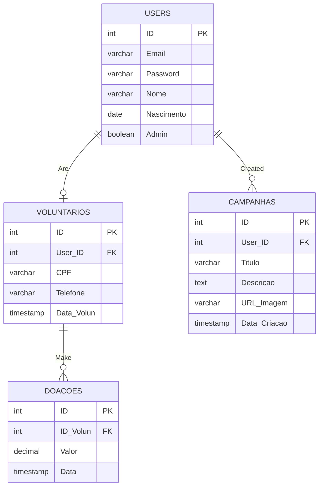

<div align="center">
<h1>CDQC — Cuide de Quem Cuidou</h1>

[](https://developer.mozilla.org/en-US/docs/Web/HTML)
[](https://developer.mozilla.org/en-US/docs/Web/CSS)
[](https://www.php.net/)
[](https://www.postgresql.org/)
[](https://openai.com/)
</div>
 
## Em Português: [README_pt-br.md](/documentation/README_pt-br.md)

**CDQC (Cuide de Quem Cuidou)** is a web application developed in PHP and PostgreSQL for a fictional NGO that welcomes and supports vulnerable elderly people. The website has three main goals: **raise donations**, **recruit volunteers**, and **provide institutional transparency**.
 
Visitors can learn about the NGO, fundraising campaigns, partners, and contact information. Users can create an account, edit their profile, register as volunteers, and (in a purely demonstrative flow) register donations. Administrators can manage campaigns (including image upload), as well as view registered users and donations.
 
> Academic Capstone Project. Institutional data (founded in 2015, 1200+ elderly people served, shelter center in Americana-SP) is **fictional**. The donation flow **does not** process real financial payments.
 
---
 
## 📌 Table of Contents
- [About the NGO](#about-the-ngo)
- [Features](#features)
- [Technologies](#technologies)
- [Repository Structure](#repository-structure)
- [How to Run Locally](#how-to-run-locally)
- [Create or Promote an Administrator](#create-or-promote-an-administrator)
- [Requirements Specification](#requirements-specification)
- [Database](#database)
- [Accessibility and Visual Identity](#accessibility-and-visual-identity)
- [Documentation](#documentation)
- [Version History](#version-history)
- [AI Usage](#ai-usage)
---
 
## About the NGO
 
**Mission:** To assist elderly individuals in delicate situations, whether living on the streets or whose families lack the resources to care for them daily, by sending volunteers daily to assist them or offering shelter in our care center. The NGO seeks to ensure dignity, quality of life, and social inclusion for the elderly population.
 
**Vision:** To transform society so that aging is viewed with dignity, autonomy, and respect, actively combating ageism (age discrimination).
 
**Values:** Respect for life stories, empathy, transparency, social innovation, equity, affection, and love.
 
**Target Audience:** Senior citizens, families in vulnerable situations, friends, and prospective volunteers.
 
---
 
## Features
 
#### **Visitor**
- Navigate through Home, About Us, Campaigns, Transparency, Partners, and Contact.
- Create an account and log in.
#### **Logged-in User**
- View and edit profile.
- Register as a volunteer.
- End the session with password confirmation.
#### **Volunteer**
- All regular user capabilities, plus **registering donations** (theoretical flow without actual charging).
#### **Administrator**
- Create, edit, and remove campaigns, including image upload (JPG, PNG, or WEBP, up to 5 MB).
- View registered users and volunteers.
- View donation history.
---
 
## Technologies
 
- **PHP**, following a client-server architecture.
- **PostgreSQL** for data persistence (in some cloud tests, **Supabase** was used as the database server).
- **HTML + CSS** (`style/style.css`), featuring a responsive hamburger menu and a partner carousel.
---
 
## Repository Structure
 
```text
.
├── admin/            # Exclusive admin actions, plus view_donations.php, delete_volunteer.php & view_volunteer.php
│   ├── create_campaign.php
│   ├── update_campaign.php
│   ├── delete_campaign.php
│   └── verify_adm.php
├── auth/             # Account and user session management
│   ├── sign_up.php
│   ├── login.php
│   ├── logout.php
│   ├── profile.php
│   ├── edit.php
│   ├── delete.php
│   └── verify_user.php
├── database/         # Database connection and SQL setup scripts
│   ├── tables.pgsql
│   └── connect.php
├── volunteers/       # Volunteering modules
│   ├── volunteer.php
│   ├── delete_volunteer.php
│   ├── view_volunteer.php
│   └── verify_volun.php
├── donations/        # Donations management
│   ├── donate.php
│   └── view_donations.php
├── pages/            # Institutional pages
│   ├── about.php
│   ├── campaigns.php
│   ├── contact.php
│   ├── partners.php
│   └── transparency.php
├── includes/         # Shared components and functions
│   ├── header.php
│   ├── footer.php
│   └── functions.php
├── documentation/    # SRS, briefing, BCD, and documentation
├── images/           # Media files, partner logos, and wireframes/prototypes
├── style/style.css   # Custom CSS styling generated with OpenAI Codex support
├── AGENTS.md         # Guidelines read by Codex to assist with CSS styling
└── index.php         # Homepage
```
 
---
 
## How to Run Locally
 
### Prerequisites
 
- **PHP** with `PDO` and `pdo_pgsql` extensions enabled (verify with `php -m`).
- **PostgreSQL** installed and running (or a Supabase cloud project).
- **Git**.
### Step 1: Clone the repository
 
```bash
git clone https://github.com/rafzsxl/cuide_dequem_cuidou.git
cd cuide_dequem_cuidou
```
 
### Step 2: Create the database
 
Create a dedicated user for the application (do not use `postgres`) and a database owned by this user.
 
To log into PostgreSQL:
 
```bash
psql -U postgres
```
 
To create the user and database:
 
```sql
CREATE USER cdqc WITH PASSWORD 'cdqc123';
CREATE DATABASE cdqc OWNER cdqc;
\q
```
 
### Step 3: Create tables
 
Execute the `database/tables.pgsql` script in the newly created database:
 
```bash
psql -h 127.0.0.1 -U cdqc -d cdqc -f database/tables.pgsql
```
 
This script creates the `users`, `voluntarios`, `campanhas`, and `doacoes` tables, and inserts a demo administrator account (email: `adm@gmail.com`, password: `adm123`).
 
> Do not re-run this script on an existing database: it recreates tables from scratch and does not replace migrations.
 
### Step 4: Configure the connection
 
The database connection (via PDO) is managed in `database/connect.php`, which defines four variables at the top of the file:
 
```php
$host   = "127.0.0.1";   // PostgreSQL server address
$dbname = "cdqc";        // Database name
$user   = "cdqc";        // Database username
$pass   = "cdqc123";     // Database password
```
 
Adjust these values to match your local environment. **Do not publish real passwords to the repository.** If using Supabase, set your project's connection details here.
 
### Step 5: Start the application
 
In the root directory of the project, open your terminal and run:
 
```bash
php -S localhost:8000
```
 
Access `http://localhost:8000` in your web browser.
 
> PHP's built-in web server is intended for development and evaluation purposes only, not for production.
 
---
 
## Create or Promote an Administrator
 
Public registration creates standard user accounts. There are two ways to get an admin account:
 
- **Demo Account:** `database/tables.pgsql` automatically inserts `adm@gmail.com` with the password `adm123`. Use this **only in development** environments and change the password or remove the account before deployment.
- **Promote your own account:** Register an account via `sign_up.php`, connect to your database, and set the `admin` column to true:
```sql
UPDATE users SET admin = TRUE WHERE email = 'your_email@example.com';
SELECT email, admin FROM users WHERE admin = TRUE;
```
 
With an admin account logged in, the **View Users** and **View Donations** buttons will appear in the header, and **ADD**, **Edit**, and **Remove** buttons will be enabled on the campaigns page.
 
---
 
## Requirements Specification
 
Below is a summary. The full specification of functional requirements, business rules, and non-functional requirements is available in the [complete documentation](documentation/documentation.md).
 
### Functional Requirements (FR)
 
| ID | Title | Description | Page |
| --- | --- | --- | --- |
| FR001 | User Registration | Visitor registers by providing name, email, phone, CPF, and password. | `sign_up.php` |
| FR002 | Login | User logs in with email and password; unregistered visitors are redirected to sign-up. | `login.php` |
| FR003 | Logout | Ends the active session after password confirmation. | `logout.php` |
| FR004 | View Profile | Displays the currently logged-in user's profile data. | `profile.php` |
| FR005 | Edit Profile | Allows editing email, CPF, password, and phone number. | `edit.php` |
 
### Business Rules (BR)
 
| ID | Rule |
| --- | --- |
| BR001 | Registration must be validated before access is granted (e.g., email confirmation). |
| BR002 | Only administrators can create, edit, or remove campaigns. |
| BR003 | Donations do not process real financial charges. |
| BR004 | After logging out, a new login is required to access restricted areas. |
| BR005 | Only logged-in users who are registered as volunteers can donate; others are directed to volunteer registration. |
 
### Non-Functional Requirements (NFR)
 
| ID | Title | Description |
| --- | --- | --- |
| NFR001 | Accessibility | Follow WCAG 2.1 level AA guidelines, ensuring suitable contrast for elderly users. |
| NFR002 | Technology | PHP with PostgreSQL. |
| NFR003 | Data Security | Securely store personal data, avoiding exposure of passwords, emails, and CPF numbers. |
 
### Constraints
 
- The content for **Transparency** and **Partners** is static (hardcoded), without database persistence.
[Full Documentation](documentation/documentation.md)
 
---
 
## Database
 
The database contains four tables: `USERS`, `VOLUNTARIOS`, `DOACOES`, and `CAMPANHAS`.
 

 
---
 
## Accessibility and Visual Identity
 
- Adheres to **WCAG 2.1 AA** guidelines to accommodate senior citizens and visually impaired users with high-contrast text.
- **Palette:** Light and cool colors (blue, green, purple) combined with softer warm accents (red).
- Clean and inclusive layout designed for elderly accessibility.
---
 
## Documentation
 
Project documentation files are located in `documentation/`:
 
- [`briefing.md`](documentation/briefing.md): mission, vision, values, target audience, and visual identity.
- [`bcd.md`](documentation/bcd.md): data modeling and data dictionary.
- [`documentation.md`](documentation/documentation.md): complete documentation (SRS, version history, and AI usage).
Portuguese versions are also available (with the `_pt-br` suffix).
 
---
 
## Version History
 
| Version |    Date    | Changes |
|--------:|:----------:|:--------|
|    1.0  | 2026-09-18 | Initial project structure setup |
|    1.1  | 2026-09-20 | Scope and objectives refinement |
|    1.2  | 2026-09-24 | Added files for Registration, Login, and Logout |
|    1.3  | 2026-09-24 | Complete specification of FR, BR, and NFR |
|    1.4  | 2026-09-26 | Finalized documentation & cloud deployment release |
|    1.5  | 2026-09-27 | Documentation fixes and Header/Footer implementation |
|    1.6  | 2026-09-27 | Added static content to "index", "transparency", "partners", "donate", "contact", and "about" (without PHP) |
|    1.7  | 2026-09-29 | Added content to "logout.php", "sign_up.php", and created "edit.php" (backend integration pending) |
|    1.8  | 2026-09-30 | Path bug fixes, created "donations" folder and "profile.php", added header navigation, updated BCD structure ("Nome" and "Nascimento" moved to Users; "Telefone" and "CPF" to Voluntários) |
|    1.9  | 2026-09-30 | Added more content and implemented core functions |
|    2.0  | 2026-10-02 | Implemented Login feature |
|    2.1  | 2026-10-02 | Implemented Edit Profile, Logout, and Delete Account functions |
|    2.2  | 2026-10-04 | Implemented Volunteer registration feature |
|    2.2  | 2026-10-07 | FIX: Corrected Volunteer registration and added Volunteer profile viewing feature |
|    2.3  | 2026-10-07 | Implemented various new functionalities |
|    2.4  | 2026-10-08 | Started site styling and created admin profile pages |
|    2.5  | 2026-10-09 | Fixed path issues and added campaign viewing capabilities |
|    2.6  | 2026-10-09 | Implemented functions across main and special pages |
|    2.7  | 2026-10-09 | Fixed path errors and improved Admin UI/UX |
|    2.8  | 2026-10-10 | Added carousel animation to partners page, updated documentation, and enhanced Admin UX |
|    2.9  | 2026-10-11 | Added images to index, applied styling via OpenAI Codex, and fixed `update_campaign.php` |
|    3.1  | 2026-10-13 | Added prototyping links and Table of Contents to documentation |
|    3.2  | 2026-10-13 | Adjusted paths in Portuguese README (`README_pt-br.md`) |
|    3.3  | 2026-10-13 | UI/UX and styling polish |
|    3.4   | 2026-10-13 | Adding README.md in English |
|    3.5   | 2026-10-14 | Fixing the deletar_user Function |
 
---
 
## AI Usage
 
| AI Model | Date | Purpose |
| ---: | :---: | :--- |
| Claude | 2026-09-20 | NGO naming ideas |
| Gemini | 2026-09-20 | CDQC logo generation |
| Claude | 2026-09-22 | Generating questions to structure the project briefing |
| Claude | 2026-09-27 | Reviewing core principles |
| Claude | 2026-09-27 | Creating background story for CDQC |
| Claude | 2026-10-02 | Assistance in fixing `atualizar_user` function |
| Claude | 2026-10-07 | Assistance writing SQL INNER JOIN queries |
| Codex  | 2026-10-11 | Assistance styling CDQC with CSS |
| Gemini | 2026-10-11 | Image generation for home page (`index`) |
| Claude | 2026-10-11 | Assistance testing Supabase as a cloud PostgreSQL server |
