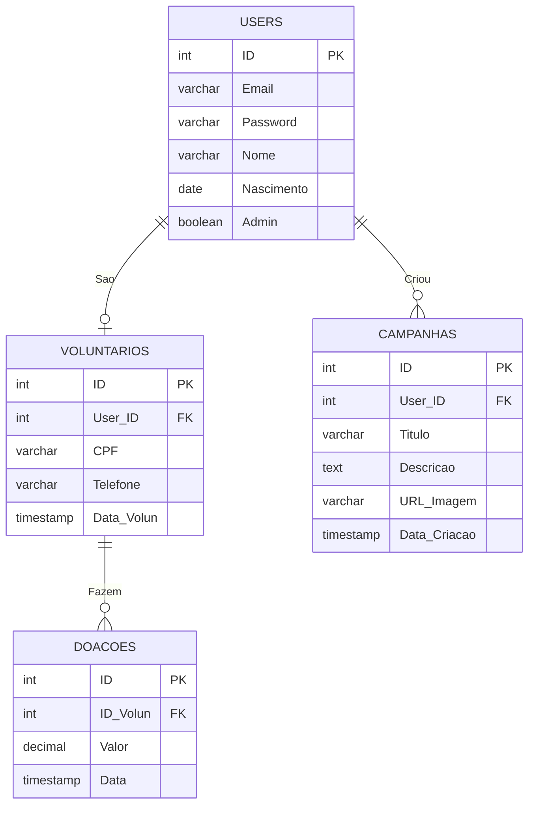

<div align="center">
<h1>CDQC — Cuide de Quem Cuidou</h1>

[](https://developer.mozilla.org/pt-BR/docs/Web/HTML)
[](https://developer.mozilla.org/pt-BR/docs/Web/CSS)
[](https://www.php.net/)
[](https://www.postgresql.org/)
[](https://openai.com/)
</div>
 
## In English: [README.md](../README.md)

A **CDQC (Cuide de Quem Cuidou)** é uma aplicação web desenvolvida em PHP e PostgreSQL para uma ONG fictícia que acolhe e apoia idosos em situação de vulnerabilidade. O site tem três objetivos: **captar doações**, **recrutar voluntários** e **entregar transparência institucional**.
 
Visitantes podem conhecer a ONG, as campanhas de arrecadação, os parceiros e as informações de contato. Usuários podem criar conta, editar o perfil, se cadastrar como voluntários e (em fluxo apenas demonstrativo) registrar doações. Administradores podem gerenciar campanhas, com upload de imagem, e consultar usuários e doações.
 
> Projeto Integrador acadêmico. Os dados institucionais (fundação em 2015, +1200 idosos atendidos, centro de acolhimento em Americana-SP) são **fictícios**. O fluxo de doação **não** processa pagamentos reais.
 
---
 
## 📌 Sumário
- [Sobre a ONG](#sobre-a-ong)
- [Funcionalidades](#funcionalidades)
- [Tecnologias](#tecnologias)
- [Estrutura do repositório](#estrutura-do-repositório)
- [Como executar localmente](#como-executar-localmente)
- [Criar ou promover um administrador](#criar-ou-promover-um-administrador)
- [Especificação de requisitos](#especificação-de-requisitos)
- [Banco de dados](#banco-de-dados)
- [Acessibilidade e identidade visual](#acessibilidade-e-identidade-visual)
- [Documentação](#documentação)
- [Histórico de versões](#histórico-de-versões)
- [Utilização de IA](#utilização-de-ia)
---
 
## Sobre a ONG
 
**Missão:** ajudar idosos em situações delicadas, seja em situação de rua ou cujos filhos não têm condições de cuidar deles no dia a dia, enviando voluntários diariamente para auxiliá-los ou oferecendo abrigo no centro de acolhimento. A ONG busca garantir dignidade, qualidade de vida e inclusão social à população da terceira idade.
 
**Visão:** transformar a sociedade para que o envelhecimento seja visto com dignidade, autonomia e respeito, combatendo ativamente o idadismo (preconceito por idade).
 
**Valores:** respeito à história de vida, empatia, transparência, inovação social, equidade, afeto e amor.
 
**Público-alvo:** idosos, familiares em situação de vulnerabilidade, amigos e possíveis voluntários.
 
---
 
## Funcionalidades
 
#### **Visitante**
- Navegar por Início, Quem Somos, Campanhas, Transparência, Parceiros e Contato.
- Criar conta e fazer login.
#### **Usuário logado**
- Visualizar e editar o perfil.
- Cadastrar-se como voluntário.
- Encerrar a sessão, com confirmação por senha.
#### **Voluntário**
- Tudo o que o usuário comum faz, além de **registrar doações** (fluxo teórico, sem cobrança real).
#### **Administrador**
- Criar, editar e remover campanhas, com upload de imagem (JPG, PNG ou WEBP, até 5 MB).
- Visualizar usuários e voluntários cadastrados.
- Visualizar o histórico de doações.
---
 
## Tecnologias
 
- **PHP**, seguindo arquitetura cliente-servidor.
- **PostgreSQL** para persistência (em alguns testes na nuvem, foi utilizado o **Supabase** como servidor).
- **HTML + CSS** (`style/style.css`), com menu hambúrguer responsivo e carrossel de parceiros.
---
 
## Estrutura do repositório
 
```text
.
├── admin/            # Ações exclusivas do ADM, além dos arquivos view_donations.php, delete_volunteer.php && view_volunteer
│   ├── create_campaign.php
│   ├── update_campaign.php
│   ├── delete_campaign.php
│   └── verify_adm.php
├── auth/             # Conta e sessão do usuário
│   ├── sign_up.php
│   ├── login.php
│   ├── logout.php
│   ├── profile.php
│   ├── edit.php
│   ├── delete.php
│   └── verify_user.php
├── database/         # Script SQL das tabelas e conexão com o banco
│   ├── tables.pgsql
│   └── connect.php
├── volunteers/       # Voluntariado
│   ├── volunteer.php
│   ├── delete_volunteer.php
│   ├── view_volunteer.php
│   └── verify_volun.php
├── donations/        # Doações
│   ├── donate.php
│   └── view_donations.php
├── pages/            # Páginas institucionais
│   ├── about.php
│   ├── campaigns.php
│   ├── contact.php
│   ├── partners.php
│   └── transparency.php
├── includes/         # Componentes e funções compartilhados
│   ├── header.php
│   ├── footer.php
│   └── functions.php
├── documentation/    # SRS, briefing, BCD e documentacao
├── images/           # Mídia, parceiros e protótipo
├── style/style.css   # Estilização feita em css com ajuda do Codex da Openai
├── AGENTS.md         # Documento lido pelo Codex para fazer a estilização com CSS
└── index.php         # Página inicial
```
 
---
 
## Como executar localmente
 
### Pré-requisitos
 
- **PHP** com as extensões `PDO` e `pdo_pgsql` habilitadas (confira com `php -m`).
- **PostgreSQL** instalado e em execução (ou um projeto no Supabase).
- **Git**.
### Passo 1: Clonar o repositório
 
```bash
git clone https://github.com/rafzsxl/cuide_dequem_cuidou.git
cd cuide_dequem_cuidou
```
 
### Passo 2: Criar o banco de dados
 
Crie um usuário próprio para a aplicação (não use `postgres`) e um banco de sua propriedade.
 
Para acessar o PostgreSQL:
 
```bash
psql -U postgres
```
 
Para criar o usuário e o banco:
 
```sql
CREATE USER cdqc WITH PASSWORD 'cdqc123';
CREATE DATABASE cdqc OWNER cdqc;
\q
```
 
### Passo 3: Criar as tabelas
 
Execute o script `database/tables.pgsql` em um banco novo:
 
```bash
psql -h 127.0.0.1 -U cdqc -d cdqc -f database/tables.pgsql
```
 
O script cria as tabelas `users`, `voluntarios`, `campanhas` e `doacoes` e insere uma conta de administrador de demonstração (e-mail `adm@gmail.com`, senha `adm123`).
 
> Não reexecute o script em um banco existente: ele cria as tabelas do zero e não substitui uma migração.
 
### Passo 4: Configurar a conexão
 
A conexão (via PDO) é feita em `database/connect.php`, que define quatro variáveis no topo do arquivo:
 
```php
$host   = "127.0.0.1";   // endereço do servidor PostgreSQL
$dbname = "cdqc";        // nome do banco
$user   = "cdqc";        // usuário do banco
$pass   = "cdqc123";     // senha do usuário
```
 
Ajuste esses valores para o seu ambiente. **Não publique senhas reais no repositório.** Se estiver usando o Supabase, use os dados de conexão do seu projeto.
 
### Passo 5: Iniciar a aplicação
 
Na raiz do projeto, abra o terminal e digite:
 
```bash
php -S localhost:8000
```
 
Acesse `http://localhost:8000`.
 
> O servidor embutido do PHP serve apenas para desenvolvimento e avaliação, não para produção.
 
---
 
## Criar ou promover um administrador
 
O cadastro público cria contas comuns. Há duas formas de ter um administrador:
 
- **Conta de demonstração:** o `database/tables.pgsql` já insere `adm@gmail.com` com a senha `adm123`. Use-a **apenas em desenvolvimento** e troque a senha ou remova a conta antes de publicar o sistema.
- **Promover uma conta sua:** crie a conta em `sign_up.php`, conecte-se ao banco e marque a coluna `admin` como verdadeira:
```sql
UPDATE users SET admin = TRUE WHERE email = 'seu_email@exemplo.com';
SELECT email, admin FROM users WHERE admin = TRUE;
```
 
Com a conta administradora, aparecem no cabeçalho os botões **Visualizar Usuários** e **Ver Doações**, e na página de campanhas os botões **ADICIONAR**, **Editar** e **Remover**.
 
---
 
## Especificação de requisitos
 
Abaixo está um resumo. A lista completa de requisitos funcionais, regras de negócio e requisitos não funcionais está na [documentação completa](documentation_pt-br.md).
 
### Requisitos funcionais (RF)
 
| ID | Título | Descrição | Página |
| --- | --- | --- | --- |
| RF001 | Cadastro de usuário | Visitante se cadastra informando nome, e-mail, telefone, CPF e senha. | `sign_up.php` |
| RF002 | Login | Login com e-mail e senha; quem não tem conta é direcionado ao cadastro. | `login.php` |
| RF003 | Logout | Encerra a sessão mediante confirmação com a senha. | `logout.php` |
| RF004 | Visualização de perfil | Exibe os dados do usuário logado. | `profile.php` |
| RF005 | Edição de perfil | Edita e-mail, CPF, senha e telefone. | `edit.php` |
 
### Regras de negócio (RN)
 
| ID | Regra |
| --- | --- |
| RN001 | O cadastro deve ser validado antes da liberação de acesso (ex.: confirmação de e-mail). |
| RN002 | Somente administradores criam, editam ou removem campanhas. |
| RN003 | A doação não processa nenhuma cobrança financeira real. |
| RN004 | Após o logout, é preciso novo login para acessar áreas restritas. |
| RN005 | Somente usuários logados e já voluntários podem doar; os demais são direcionados ao cadastro de voluntariado. |
 
### Requisitos não funcionais (RNF)
 
| ID | Título | Descrição |
| --- | --- | --- |
| RNF001 | Acessibilidade | Seguir a WCAG 2.1 nível AA, com contraste adequado, considerando o público idoso. |
| RNF002 | Tecnologia | PHP com PostgreSQL. |
| RNF003 | Segurança de dados | Armazenar dados pessoais com segurança, evitando exposição de senhas, e-mails e CPF. |
 
### Restrições
 
- O conteúdo de **Transparência** e **Parceiros** é estático (fixo no código), sem persistência em banco.
[Documentação completa em pt-br](documentation_pt-br.md)
 
---
 
## Banco de dados
 
O banco possui quatro tabelas: `USERS`, `VOLUNTARIOS`, `DOACOES` e `CAMPANHAS`.
 

 
---
 
## Acessibilidade e identidade visual
 
- Segue as diretrizes **WCAG 2.1 AA** para atender idosos e pessoas com baixa visão, com texto de alto contraste.
- **Paleta:** cores claras e frias (azul, verde, roxo) combinadas a cores quentes mais suaves (vermelho).
- Visual limpo e inclusivo para a terceira idade.
---
 
## Documentação
 
Os documentos do projeto ficam em `documentation/`:
 
- [`briefing_pt-br.md`](documentation_pt-br.md): missão, visão, valores, público e identidade visual.
- [`bcd_pt-br.md`](bcd_pt-br.md): modelagem e dicionário de dados.
- [`documentation_pt-br.md`](documentation_pt-br.md): documentação completa (SRS, histórico e uso de IA).
Existem também as versões em inglês (mesmos nomes, sem o sufixo `_pt-br`).
 
---
 
## Histórico de versões
 
| Versão | Data | Modificações |
| ---: | :---: | :--- |
| 1.0 | 2026-09-18 | Estruturação inicial do projeto |
| 1.1 | 2026-09-20 | Refinamento do escopo e objetivos |
| 1.2 | 2026-09-24 | Arquivos de cadastro, login e logout |
| 1.3 | 2026-09-24 | Preenchimento completo de RF, RN e RNF |
| 1.4 | 2026-09-26 | Finalização da documentação e lançamento para a nuvem |
| 1.5 | 2026-09-27 | Correção da documentação; header e footer |
| 1.6 | 2026-09-27 | Conteúdo estático das páginas principais |
| 1.7 | 2026-09-29 | Conteúdo de logout.php e sign_up.php; criação de edit.php |
| 1.8 | 2026-09-30 | Correção de caminhos; pasta donations e profile.php; ajuste da estrutura do banco |
| 1.9 | 2026-09-30 | Mais conteúdo e primeiras funções |
| 2.0 | 2026-10-02 | Função de login |
| 2.1 | 2026-10-02 | Funções de editar, logout e delete |
| 2.2 | 2026-10-04 | Função de voluntariar-se |
| 2.2 | 2026-10-07 | Correção do voluntariado; visualização de voluntários |
| 2.3 | 2026-10-07 | Diversas novas funções |
| 2.4 | 2026-10-08 | Início da estilização; páginas do perfil ADM |
| 2.5 | 2026-10-09 | Correção de caminhos; visualização de campanhas |
| 2.6 | 2026-10-09 | Funções nas páginas principais e especiais |
| 2.7 | 2026-10-09 | Correção de caminhos; melhoria de UI/UX do ADM |
| 2.8 | 2026-10-10 | Carrossel de parceiros; documentação e UX do ADM |
| 2.9 | 2026-10-11 | Imagens no index; estilização; correção de update_campaign.php |
 
---
 
## Utilização de IA
 
| IA | Data | Intenção |
| ---: | :---: | :--- |
| Claude | 2026-09-20 | Dar nome à ONG |
| Gemini | 2026-09-20 | Gerar logo da CDQC |
| Claude | 2026-09-22 | Gerar perguntas para estruturar o briefing |
| Claude | 2026-09-27 | Rever princípios |
| Claude | 2026-09-27 | Gerar uma história para a CDQC |
| Claude | 2026-10-02 | Ajuda com a correção da função atualizar_user |
| Claude | 2026-10-07 | Ajuda com INNER JOINs |
| Codex | 2026-10-11 | Estilização da CDQC |
| Gemini | 2026-10-11 | Gerar imagens para o index |
| Claude | 2026-10-11 | Ajuda com testes usando o Supabase como servidor |