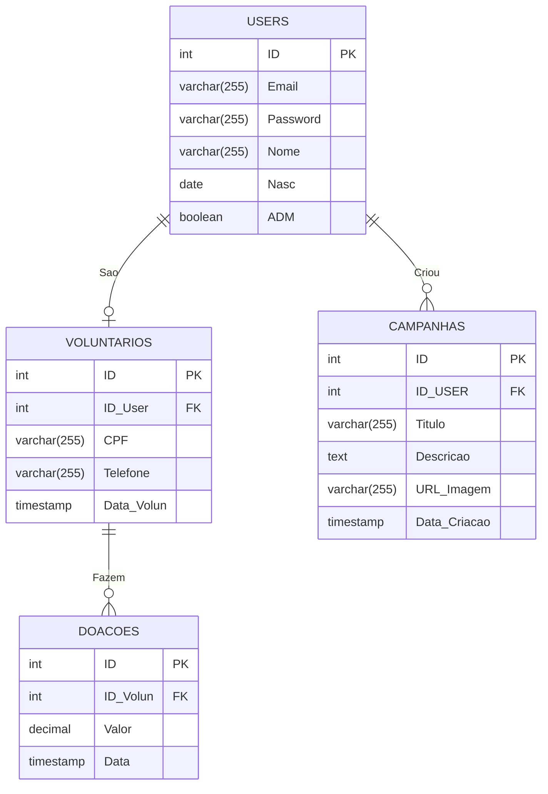

<!-- Símbolo	Significado
||--||	Um para exatamente um
||--o|	Um para zero ou um
||--o{	Um para zero ou muitos
||--|{	Um para um ou muitos
o|--|{	Zero ou um para um ou muitos -->

# Dicionário de Dados
## Diagrama
 
| ID | Tabela | Nome do Campo | Descrição do Campo | Código do Campo no Banco de Dados | Tipo da Variável | Tipo de Dados e Tamanho da Variável | Máscara Campo | Opções de Colunas |
|---|---|---|---|---|---|---|---|---|
| 1 | USERS | id | Código de identificação de cada registro de usuário | id_user | chave | INTEGER | 0-9 | Not Null, Auto Incremento |
| 2 | USERS | email | E-mail de login do usuário no sistema | email_user | simples | VARCHAR (255) | A-Z | Not Null, Unique |
| 3 | USERS | password | Senha de acesso do usuário ao sistema (armazenada em hash) | password_user | simples | VARCHAR (255) | A-Z | Not Null |
| 4 | USERS | nome | Nome completo do usuário | nome_user | simples | VARCHAR (255) | A-Z | Not Null |
| 5 | USERS | nasc | Data de nascimento do usuário | nasc_user | simples | DATE | DD/MM/AAAA | Not Null |
| 6 | USERS | adm | Indica se o usuário é administrador do sistema | adm_user | simples | BOOLEAN | 0-1 | Not Null, Default FALSE |
| 1 | VOLUNTÁRIOS | id | Código de identificação de cada registro de voluntário | id_volun | chave | INTEGER | 0-9 | Not Null, Auto Incremento |
| 2 | VOLUNTÁRIOS | id_user | Código do usuário que se tornou voluntário, proveniente do relacionamento com a tabela USERS | id_user_fk | estrangeira | INTEGER | 0-9 | Not Null, Unique |
| 3 | VOLUNTÁRIOS | cpf | Número do Cadastro de Pessoa Física do voluntário | cpf_volun | simples | VARCHAR (255) | 000.000.000-00 | Not Null, Unique |
| 4 | VOLUNTÁRIOS | telefone | Telefone de contato do voluntário, com DDD | telefone_volun | simples | VARCHAR (255) | (00) 00000-0000 | Not Null |
| 5 | VOLUNTÁRIOS | data_volun | Data e hora em que o usuário se tornou voluntário | data_volun | simples | TIMESTAMP | DD/MM/AAAA hh:mm:ss | Not Null, Default CURRENT_TIMESTAMP |
| 1 | DOAÇÕES | id | Código de identificação de cada registro de doação | id_doa | chave | INTEGER | 0-9 | Not Null, Auto Incremento |
| 2 | DOAÇÕES | id_volun | Código do voluntário que realizou a doação, proveniente do relacionamento com a tabela VOLUNTÁRIOS | id_volun_fk | estrangeira | INTEGER | 0-9 | Not Null |
| 3 | DOAÇÕES | valor | Valor da doação, em reais | valor_doa | simples | DECIMAL (10,2) | 0-9 | Not Null |
| 4 | DOAÇÕES | data | Data e hora em que a doação foi realizada | data_doa | simples | TIMESTAMP | DD/MM/AAAA hh:mm:ss | Not Null, Default CURRENT_TIMESTAMP |
| 1 | CAMPANHAS | id | Código de identificação de cada registro de campanha | id_camp | chave | INTEGER | 0-9 | Not Null, Auto Incremento |
| 2 | CAMPANHAS | id_user | Código do usuário que criou a campanha, proveniente do relacionamento com a tabela USERS | id_user_fk | estrangeira | INTEGER | 0-9 | Not Null |
| 3 | CAMPANHAS | titulo | Título da campanha | titulo_camp | simples | VARCHAR (255) | A-Z | Not Null |
| 4 | CAMPANHAS | descricao | Descrição detalhada da campanha | descricao_camp | simples | TEXT | A-Z | |
| 5 | CAMPANHAS | url_imagem | Endereço (link) da imagem de capa da campanha | url_imagem_camp | simples | VARCHAR (255) | A-Z | |
| 6 | CAMPANHAS | data_criacao | Data e hora em que a campanha foi criada | data_criacao_camp | simples | TIMESTAMP | DD/MM/AAAA hh:mm:ss | Not Null, Default CURRENT_TIMESTAMP |

## Descrição de Tabelas
 | ID | Nome da Tabela | Descrição da Tabela | Quantidade de Atributos | Tabelas Relacionadas | Cardinalidade Máxima | Cardinalidade Mínima |
|---|---|---|---|---|---|---|
| 1 | USERS | Armazenamento dos dados de cadastro dos usuários do sistema | 6 | VOLUNTÁRIOS CAMPANHAS | VOLUNTÁRIOS (1:1) CAMPANHAS (1:N) | VOLUNTÁRIOS (1:0) CAMPANHAS (1:0) |
| 2 | VOLUNTÁRIOS | Armazenamento dos dados complementares dos usuários que se tornam voluntários | 5 | USERS DOAÇÕES | USERS (1:1) DOAÇÕES (1:N) | USERS (0:1) DOAÇÕES (1:0) |
| 3 | DOAÇÕES | Armazenamento dos dados das doações realizadas pelos voluntários | 4 | VOLUNTÁRIOS | VOLUNTÁRIOS (N:1) | VOLUNTÁRIOS (0:1) |
| 4 | CAMPANHAS | Armazenamento dos dados das campanhas criadas pelos usuários | 6 | USERS | USERS (N:1) | USERS (0:1) |