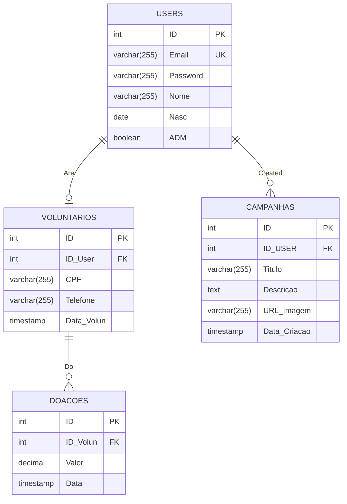

# Entity-Relationship Diagram
## Em Portugues: [BCD](bcd_pt-br.md)

<!-- Symbol	Meaning
||--||	One to exactly one
||--o|	One to zero or one
||--o{	One to zero or many
||--|{	One to one or many
o|--|{	Zero or one to one or many -->

# Data Dictionary
## Diagram

| ID | Table | Field Name | Field Description | Database Field Code | Variable Type | Data Type and Variable Size | Field Mask | Column Options |
|---|---|---|---|---|---|---|---|---|
| 1 | USERS | id | Identification code of each user record | id_user | key | INTEGER | 0-9 | Not Null, Auto Increment |
| 2 | USERS | email | User's login email in the system | email_user | simple | VARCHAR (255) | A-Z | Not Null, Unique |
| 3 | USERS | password | User's password to access the system (stored as a hash) | password_user | simple | VARCHAR (255) | A-Z | Not Null |
| 4 | USERS | name | User's full name | nome_user | simple | VARCHAR (255) | A-Z | Not Null |
| 5 | USERS | birth_date | User's date of birth | nasc_user | simple | DATE | DD/MM/YYYY | Not Null |
| 6 | USERS | admin | Indicates whether the user is a system administrator | adm_user | simple | BOOLEAN | 0-1 | Not Null, Default FALSE |
| 1 | VOLUNTARIOS | id | Identification code of each volunteer record | id_volun | key | INTEGER | 0-9 | Not Null, Auto Increment |
| 2 | VOLUNTARIOS | id_user | Code of the user who became a volunteer, from the relationship with the USERS table | id_user_fk | foreign | INTEGER | 0-9 | Not Null, Unique |
| 3 | VOLUNTARIOS | cpf | Volunteer's Individual Taxpayer Registry (CPF) number | cpf_volun | simple | VARCHAR (255) | 000.000.000-00 | Not Null, Unique |
| 4 | VOLUNTARIOS | phone | Volunteer's contact phone number, with area code | telefone_volun | simple | VARCHAR (255) | (00) 00000-0000 | Not Null |
| 5 | VOLUNTARIOS | volunteer_date | Date and time when the user became a volunteer | data_volun | simple | TIMESTAMP | DD/MM/YYYY hh:mm:ss | Not Null, Default CURRENT_TIMESTAMP |
| 1 | DOACOES | id | Identification code of each donation record | id_doa | key | INTEGER | 0-9 | Not Null, Auto Increment |
| 2 | DOACOES | id_volun | Code of the volunteer who made the donation, from the relationship with the VOLUNTARIOS table | id_volun_fk | foreign | INTEGER | 0-9 | Not Null |
| 3 | DOACOES | amount | Donation amount, in Brazilian reais | valor_doa | simple | DECIMAL (10,2) | 0-9 | Not Null |
| 4 | DOACOES | date | Date and time when the donation was made | data_doa | simple | TIMESTAMP | DD/MM/YYYY hh:mm:ss | Not Null, Default CURRENT_TIMESTAMP |
| 1 | CAMPANHAS | id | Identification code of each campaign record | id_camp | key | INTEGER | 0-9 | Not Null, Auto Increment |
| 2 | CAMPANHAS | id_user | Code of the user who created the campaign, from the relationship with the USERS table | id_user_fk | foreign | INTEGER | 0-9 | Not Null |
| 3 | CAMPANHAS | title | Campaign title | titulo_camp | simple | VARCHAR (255) | A-Z | Not Null |
| 4 | CAMPANHAS | description | Detailed description of the campaign | descricao_camp | simple | TEXT | A-Z | |
| 5 | CAMPANHAS | image_url | Address (link) of the campaign's cover image | url_imagem_camp | simple | VARCHAR (255) | A-Z | |
| 6 | CAMPANHAS | creation_date | Date and time when the campaign was created | data_criacao_camp | simple | TIMESTAMP | DD/MM/YYYY hh:mm:ss | Not Null, Default CURRENT_TIMESTAMP |

## Table Descriptions
 | ID | Table Name | Table Description | Number of Attributes | Related Tables | Maximum Cardinality | Minimum Cardinality |
|---|---|---|---|---|---|---|
| 1 | USERS | Storage of registration data for the system's users | 6 | VOLUNTARIOS CAMPANHAS | VOLUNTARIOS (1:1) CAMPANHAS (1:N) | VOLUNTARIOS (1:0) CAMPANHAS (1:0) |
| 2 | VOLUNTARIOS | Storage of supplementary data for users who become VOLUNTARIOS | 5 | USERS DOACOES | USERS (1:1) DOACOES (1:N) | USERS (0:1) DOACOES (1:0) |
| 3 | DOACOES | Storage of data on DOACOES made by VOLUNTARIOS | 4 | VOLUNTARIOS | VOLUNTARIOS (N:1) | VOLUNTARIOS (0:1) |
| 4 | CAMPANHAS | Storage of data on CAMPANHAS created by users | 6 | USERS | USERS (N:1) | USERS (0:1) |